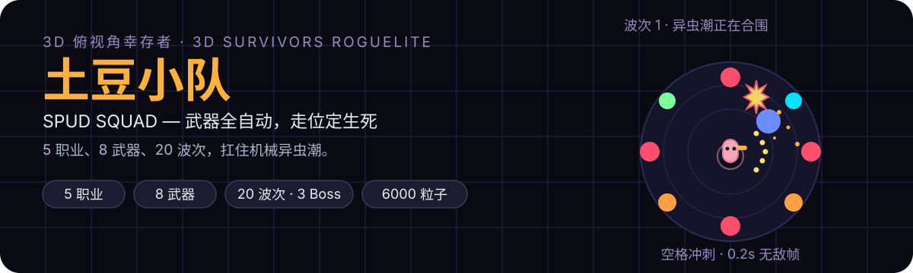
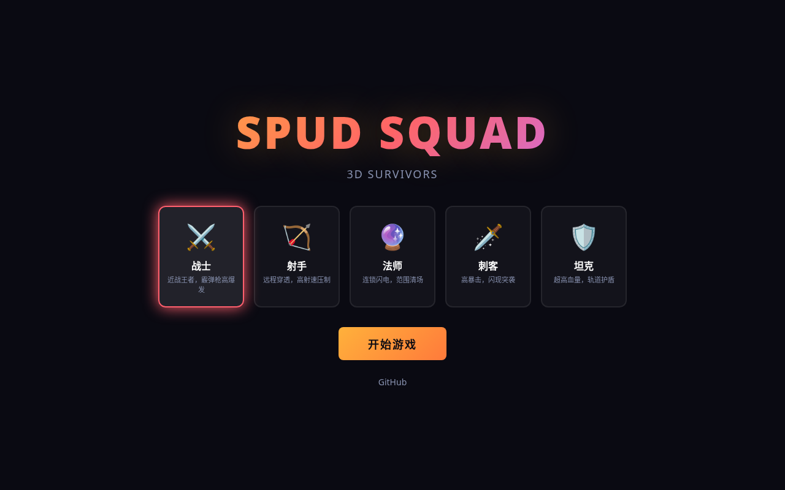
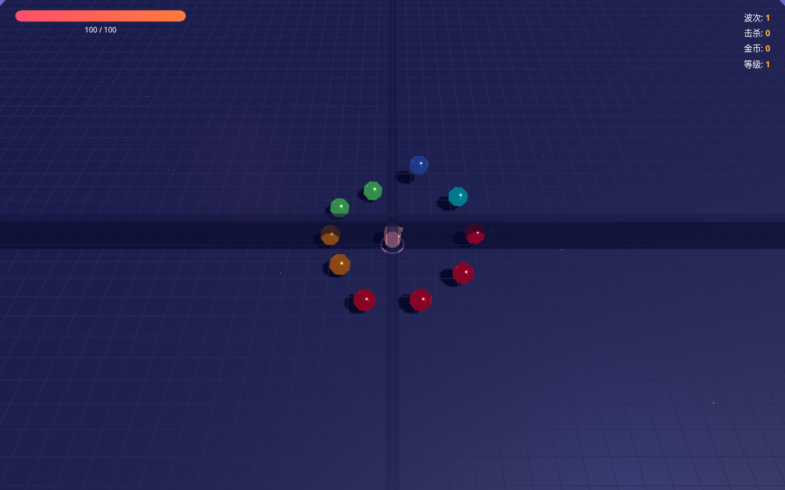

<p align="right"><a href="README.md">中文</a></p>

<p align="center">
  
</p>

<p align="center">
  <a href="https://xiaosang.cc/spud-squad/">▶ Play Online</a>
  ·
  <a href="https://github.com/holynova/spud-squad">GitHub Repository</a>
</p>

Spud Squad is a 3D top-down wave-based survivors roguelite inspired by Brotato: pilot an armed metal potato against endless waves of mechanical bugs in a futuristic arena. Weapons auto-aim and auto-fire — you focus on positioning, dashing, and building your loadout. 20 waves, a boss every 5, survive to the end to win. Three.js + Vite, desktop keyboard controls.

## Screenshots

<p align="center">
  
</p>

<p align="center">
  
</p>

## How to Play

- **Move**: WASD or arrow keys; keep kiting to bunch enemies inside your weapons' range.
- **Dash**: Space — 0.2s of invulnerability plus a speed burst, 1.5s cooldown; use it to break out when the ring closes in.
- **Shoot**: fully automatic — weapons lock onto the nearest high-threat target.
- **Level up**: collect XP crystals; each level, pick 1 of 3 cards to power up.
- **Win**: clear all 20 waves; the run ends when your health hits zero.

## Characters

5 potato warriors, each with a starting weapon and a unique active skill:

| Character | Starting Weapon | Active Skill |
|:---|:---|:---|
| **战士 Warrior** ⚔️ | 霰弹枪 Shotgun | **狂暴 Berserk**: +80% attack speed for 3s |
| **射手 Ranger** 🏹 | 冲锋枪 SMG | **穿透射击 Pierce**: bullets pierce +3 for 5s |
| **法师 Mage** 🔮 | 特斯拉 Tesla | **闪电风暴 Storm**: chain lightning bounces +4 for 4s |
| **刺客 Assassin** 🗡️ | 飞刀 Knife | **影袭 Shadow Strike**: +40% crit chance for 2s |
| **坦克 Tank** 🛡️ | 轨道炮 Orbital Cannon | **钢铁壁垒 Bulwark**: 60% damage reduction for 4s |

## Weapons

8 weapons, each up to Lv.5, max 6 held at once:

- **霰弹枪 Shotgun**: cone spread, 10 pellets and 20 damage at max level; **冲锋枪 SMG**: very high fire rate, pierce 2 at max; **狙击枪 Sniper**: extreme range and penetration, 150 damage and pierce 8 at max.
- **火箭筒 Rocket Launcher**: area explosion, blast radius 5.5 at max; **特斯拉 Tesla**: chain lightning, 8 bounce targets at max; **冰冻射线 Frost Ray**: cone slow, range 14 and 55% slow at max.
- **轨道炮 Orbital Cannon**: orbiting projectiles guard you, 5 satellites at max; **飞刀 Knife**: boomerang double damage, 3 knives per throw at max.

## Enemies & Bosses

- **8 enemy types**: grunt, rusher (short dash), brute (high HP and armor), shooter (ranged), lancer (high-speed charge after a red-line warning), swarm (tiny clusters), splitter (splits into 3 swarmers on death), elite (appears after wave 9).
- **3 bosses** (one every 5 waves): wave 5 **熔核巨像 Molten Colossus** (3,000 HP, ring bullet patterns + charge), wave 10 **冰霜领主 Frost Lord** (5,000 HP, ice-ring summons + slow field), wave 15 **虚空吞噬 Void Devourer** (9,000 HP, black-hole pull + full-screen barrages). Wave 20 is the final stand.

## Upgrades

On each level-up, pick 1 of 3 cards drawn from a 14-card pool: attack power, attack speed, max health, movement speed, area, crit chance, crit damage, armor, pickup range, XP gain, coin gain, health regen — plus two epic cards, **武器升级 Weapon Upgrade** (a random weapon gains 1 level) and **新武器 New Weapon** (gain a random new weapon).

## Run Locally

```bash
git clone https://github.com/holynova/spud-squad.git
cd spud-squad
npm install
npm run dev      # dev server with HMR
npm run build    # production build into dist/
npm run preview  # preview the production build
```

## Tech

- Three.js 0.186.1 (WebGL rendering) + Vite 8.3.1, pure ES Modules, no UI framework.
- Custom particle system: a 6,000-particle pool with custom shaders — tracer fire, hit sparks, explosion shockwaves, level-up bursts.
- Object pooling for enemies and projectiles; waves, enemies, weapons and upgrades are all data-driven.

```
index.html              Entry (menu / HUD / upgrade draft / results, inline styles)
src/main.js             Startup: create canvas, Game + UI
src/game/game.js       Main loop: waves, spawning, collisions, results
src/game/player.js     Player: movement, dash, weapon mounts
src/game/enemies.js    Enemy pools and behaviors (chase / charge / ranged / boss)
src/game/enemyDefs.js  Enemy and boss stat tables
src/game/weaponDefs.js 8 weapon stats and 5-level growth
src/game/upgrades.js   14-card upgrade pool and drafting
src/game/characters.js 5 character stats and skills
src/fx/particles.js     Particle system (6,000-particle pool)
src/fx/effects.js       Shockwaves, decals and other effects
src/core/               Input, loop, object pool, audio, utilities
```
