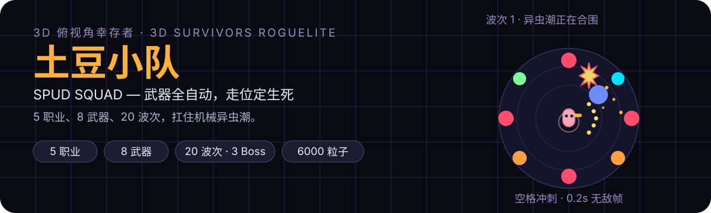
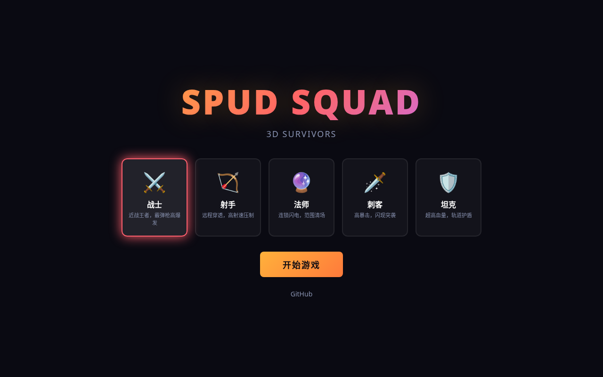
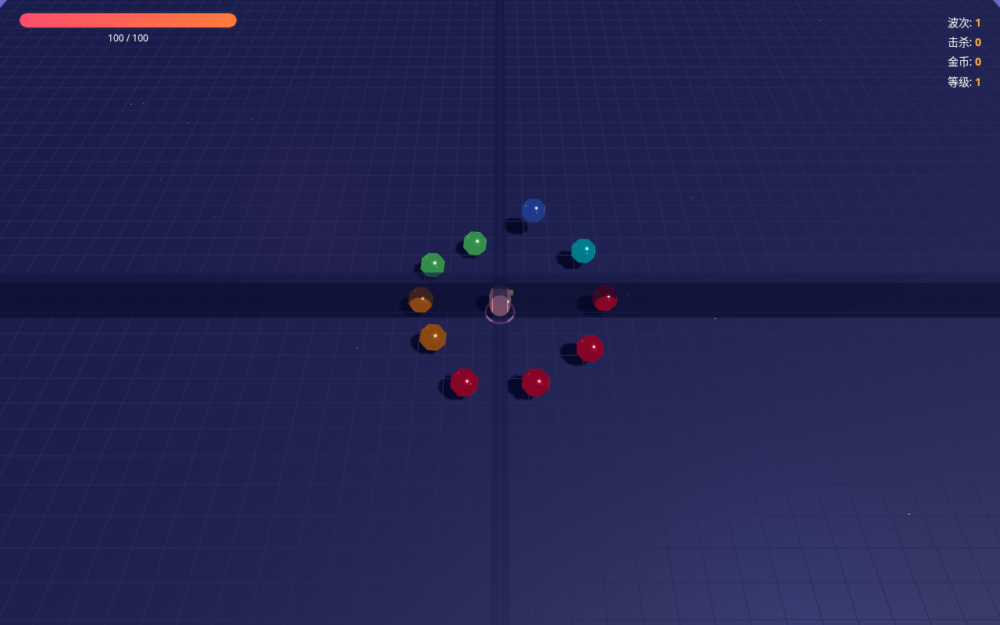

<p align="center">
  
</p>

<p align="center">
  <a href="https://xiaosang.cc/spud-squad/">▶ 在线玩 Play Online</a>
  ·
  <a href="https://github.com/holynova/spud-squad">GitHub 仓库</a>
</p>

土豆小队是一款 3D 俯视角波次幸存者 Roguelite（受《土豆兄弟》启发）：操纵全副武装的金属土豆战士，在未来感竞技场中迎战源源不断的机械异虫潮。武器全自动索敌，你只管走位、冲刺与构筑。20 个波次，每 5 波一只 Boss，活到最后即通关。Three.js + Vite，桌面端键盘操作。

Spud Squad is a 3D top-down wave-based survivors roguelite inspired by Brotato: pilot an armed metal potato against endless waves of mechanical bugs. Weapons auto-aim and auto-fire — you focus on positioning, dashing, and building your loadout. 20 waves, a boss every 5, survive to the end to win. Three.js + Vite, desktop keyboard controls.

## 截图 / Screenshots

<p align="center">
  
</p>

<p align="center">
  
</p>

## 玩法 / How to Play

- **移动**：WASD 或方向键走位；保持拉扯，把怪群聚拢到武器射程内。
- **冲刺**：空格，0.2 秒无敌帧 + 移速爆发，冷却 1.5 秒；包围圈缩拢时用来突围。
- **射击**：全自动索敌开火，自动锁定最近的高威胁目标。
- **升级**：拾取经验水晶升级，每次从 3 张卡里选 1 张强化。
- **通关**：打满 20 波即胜利；血量归零则游戏结束。

## 职业 / Characters

5 位土豆战士，各带初始武器与专属主动技能：

| 职业 | 初始武器 | 专属技能 |
|:---|:---|:---|
| **战士** ⚔️ | 霰弹枪 | **狂暴**：3 秒内攻速 +80% |
| **射手** 🏹 | 冲锋枪 | **穿透射击**：5 秒内子弹贯穿 +3 |
| **法师** 🔮 | 特斯拉 | **闪电风暴**：4 秒内连锁弹跳 +4 |
| **刺客** 🗡️ | 飞刀 | **影袭**：2 秒内暴击率 +40% |
| **坦克** 🛡️ | 轨道炮 | **钢铁壁垒**：4 秒内减伤 60% |

## 武器 / Weapons

8 种武器，每种最高 Lv.5，最多同时持有 6 把：

- **霰弹枪**：锥形散射，满级 10 发弹丸、伤害 20；**冲锋枪**：极高射速，满级贯穿 2；**狙击枪**：超远穿透，满级伤害 150、穿透 8。
- **火箭筒**：范围爆炸，满级爆炸半径 5.5；**特斯拉**：连锁闪电，满级弹跳 8 个目标；**冰冻射线**：锥形减速，满级射程 14、减速 55%。
- **轨道炮**：弹体环绕护体，满级 5 枚卫星；**飞刀**：回旋双重伤害，满级一次 3 柄。

## 敌人与 Boss / Enemies & Bosses

- **8 种敌人**：小兵、疾行（短突刺）、重装（高血高防）、射手（远程）、突刺（红线警示后高速冲刺）、蜂群（微型集群）、分裂（死后裂成 3 只蜂群）、精英（9 波后出现）。
- **3 只 Boss**（每 5 波一只）：第 5 波**熔核巨像**（3000 HP，环形弹幕 + 冲撞）、第 10 波**冰霜领主**（5000 HP，冰环召唤 + 减速场）、第 15 波**虚空吞噬**（9000 HP，黑洞牵引 + 全屏弹幕）。第 20 波是最终决战。

## 升级 / Upgrades

升级时从 14 张卡里随机抽 3 张选 1 张：攻击力、攻击速度、生命上限、移动速度、范围扩大、暴击率、暴击伤害、护甲、拾取范围、经验加成、金币加成、生命恢复，另有两张史诗卡——**武器升级**（随机一把武器升 1 级）与**新武器**（获得一把随机新武器）。

## 本地运行 / Run Locally

```bash
git clone https://github.com/holynova/spud-squad.git
cd spud-squad
npm install
npm run dev      # 开发服务，支持 HMR
npm run build    # 生产打包到 dist/
npm run preview  # 本地预览打包产物
```

## 技术 / Tech

- Three.js 0.186.1（WebGL 渲染）+ Vite 8.3.1，纯 ES Modules，零 UI 框架。
- 自研粒子系统：6000 粒子池 + 自定义着色器，弹道火光、击中火花、爆炸冲击波、升级爆发。
- 对象池复用敌人与投射物；波次、敌人、武器、升级全部数据驱动。

```
index.html              入口（菜单 / HUD / 升级选卡 / 结算，样式内联）
src/main.js             启动：建画布、Game + UI
src/game/game.js       主循环：波次、刷怪、碰撞、结算
src/game/player.js      玩家：移动、冲刺、武器挂载
src/game/enemies.js     敌人池与行为（追击 / 冲锋 / 远程 / Boss）
src/game/enemyDefs.js   敌人与 Boss 数值表
src/game/weaponDefs.js  8 武器数值与 5 级成长
src/game/upgrades.js    14 张升级卡池与抽卡
src/game/characters.js  5 职业数值与技能
src/fx/particles.js     粒子系统（6000 池）
src/fx/effects.js       冲击波、贴花等特效
src/core/               输入、循环、对象池、音频、工具
```

## English

**Spud Squad** is a 3D top-down wave-based survivors roguelite inspired by Brotato. Your weapons auto-aim and auto-fire — you move, dash, and build.

- **Characters**: 5 potatoes — Warrior (shotgun, Berserk), Ranger (SMG, Pierce), Mage (Tesla, Storm), Assassin (knife, Shadow), Tank (orbital, Bulwark) — each with a unique active skill.
- **Weapons**: 8 weapons up to Lv.5, max 6 at once — shotgun, SMG, sniper, rocket, Tesla, frost ray, orbital, knife.
- **Waves**: 20 waves, a boss every 5 — Colossus (3,000 HP), Frost Lord (5,000 HP), Void Devourer (9,000 HP). 8 enemy types plus elites.
- **Upgrades**: pick 1 of 3 cards from a 14-card pool on each level-up, including weapon level-ups and new weapons.
- **Dash**: Space gives 0.2s of invulnerability, 1.5s cooldown.
- **Tech**: Three.js 0.186.1 + Vite 8.3.1, pure ES modules. Custom particle system with a 6,000-particle pool and shader-driven bursts.
